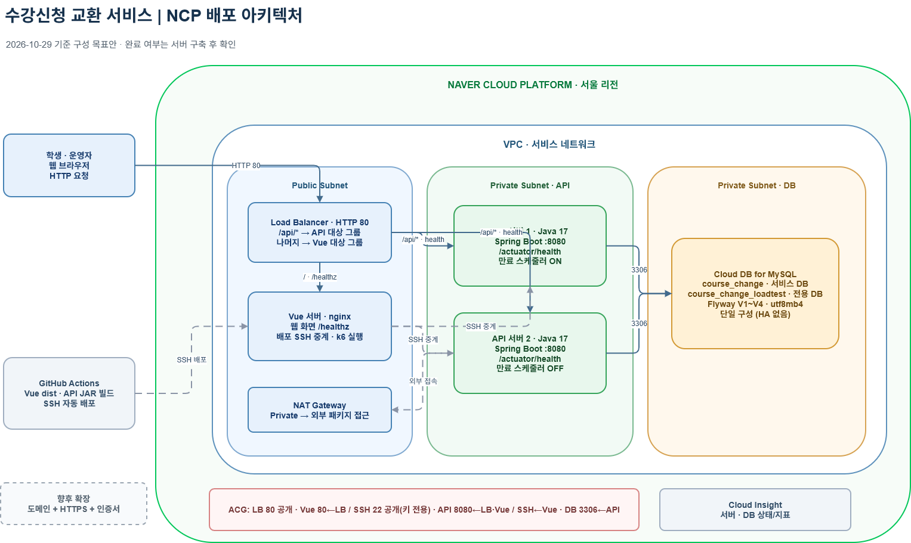

# 수강신청 교환 마켓 · 백엔드 (course_change_be)

돈 거래 없이 수강 중인 강의를 서로 맞교환하는 서비스의 백엔드입니다. 가상 학사 시스템(학생·강의·수강) 위에 교환 기능이 붙는 구조입니다. 모의 서비스이며 실제 수강신청과 무관합니다.

| 항목 | 내용 |
|---|---|
| 언어·프레임워크 | Java 17, Spring Boot 3.5 (Web, Data JPA, Validation, Actuator) |
| DB | MySQL 8.0 (스키마는 Flyway가 자동 생성) |
| 인증 | 학번 + 비밀번호 로그인 → HMAC 서명 토큰 (Bearer) |
| API 문서 | springdoc Swagger UI |
| 테스트 | JUnit 5 + Testcontainers(실제 MySQL 컨테이너) |
| CI | GitHub Actions (테스트 + jar 실행 스모크 테스트 + 시연 시나리오 리허설) |
| 배포 | NCP: LB → API 서버 오토스케일링 그룹 → Cloud DB for MySQL, main 푸시 시 롤링 배포 |

> 네이버클라우드 아카데미 **클라우드 Literacy 과정 3조** 프로젝트입니다 (고명주·한승석·강민규·김세현, 발표 2026-10-30).
> 과정이 끝나 NCP 실습 계정이 정리되어 서버는 현재 내려가 있습니다. 아래 수치와 구성은 발표자료와 GitHub Actions 실행 기록 기준입니다.

## 결과 요약

### 1. 동시 매칭 정합성 — 락 없음 vs 비관적 락

같은 강의 자리를 노리는 매칭 요청이 동시에 들어오면, 락이 없을 때 한 사람의 수강 내역이 두 매칭 세션에 동시에 묶였습니다.
운영체제의 교착 상태 조건 중 **순환 대기**를 없애기 위해, 두 요청 행과 두 좌석 행을 **항상 ID 오름차순으로** `SELECT ... FOR UPDATE` 잠금하도록 했습니다
([`MatchingService.java`](src/main/java/com/ncp03/coursechange/exchange/MatchingService.java)의 `PESSIMISTIC` 분기).
락 전략은 `APP_MATCHING_LOCK_MODE` 설정값으로 분리해 같은 jar로 두 방식을 비교했습니다.

| 조건 | 값 |
|---|---|
| 시나리오 | k6 `lt07` (동시 쓰기), [`scripts/k6/scenarios.js`](scripts/k6/scenarios.js) |
| 동시 사용자 | 20 VU, 매칭 요청 20건 |
| 대상 | NCP 로드밸런서 → API 서버 2대 (Vue 서버에서 k6 실행) |
| DB | 운영과 분리한 `course_change_loadtest`, 가상 학생 10,000명 적재 |
| 통제 | 동일 시나리오·동일 VU·동일 jar·동일 DB 백업에서 `APP_MATCHING_LOCK_MODE`만 바꿈, 모드별 1회 측정 |

| 지표 | 락 없음 (`NONE`) | 비관적 락 (`PESSIMISTIC`) |
|---|---|---|
| 매칭 요청 결과 (20건) | 성공 3 / 실패(500) 17 | **성공 20 / 실패 0** |
| 한 요청이 여러 세션에 묶임 | 2건 | **0건** |
| PENDING 세션 수 | 3개 (같은 두 사람이 3번 묶임) | 1개 |
| p95 응답시간 | 599 ms | 1,503 ms (**약 2.5배**) |
| 처리량 | 39.6 req/s | 22.0 req/s |

응답은 약 2.5배 느려졌지만, 중복 매칭은 결과 자체가 틀리는 오류라서 정합성을 택했습니다. 기본값은 `PESSIMISTIC`이고 `NONE`은 비교 실험용입니다.

### 2. 조회 폭증

| 항목 | 결과 |
|---|---|
| 시나리오 | k6 `read_spike`, 조회 사용자를 최대 32 VU까지 단계적으로 증가 |
| 부하 구간 | 약 6분 10초 |
| HTTP 요청 | 10,029건 (초당 평균 27.06건) |
| 오류 | 0건 (실패율 0.00%) |
| 응답시간 평균 / p95 | 19.72 ms / 28.11 ms |
| 기능 검사 | 12,343건 모두 통과 |

> **측정 주체**: 부하테스트 시나리오 작성과 실행·결과 분석은 한승석(메인)·강민규(서브)가 했습니다. 락 전략 분리(`APP_MATCHING_LOCK_MODE`)와 ID 오름차순 잠금 등 매칭·동시성 코드는 고명주가 맡았습니다.

### 3. 배포 — SSH 22번 인바운드 없이 배포 (셀프호스티드 러너)

처음에는 GitHub 호스팅 러너가 밖에서 Vue 서버로 SSH 접속해 배포했고, 러너 IP가 매번 바뀌어 ACG에 22번을 전체 공개로 열어 둬야 했습니다.
Vue 서버 안에 GitHub Actions **셀프호스티드 러너**를 설치해, 러너가 GitHub로 **나가는 443 연결**로 작업을 받아 오고 사설망으로 API 서버에 배포하도록 바꿨습니다. 그래서 들어오는 22번이 필요 없어졌습니다.

```
[전환 전]  GitHub 러너 ──SSH 22(인바운드, 전체 공개)──▶ Vue 서버 ──SSH──▶ API 서버
[전환 후]  GitHub ◀──HTTPS 443(아웃바운드)── 러너(Vue 서버 안) ──SSH(사설망)──▶ API 서버
```

- 전환 방식: 저장소 변수 `DEPLOY_VIA_RUNNER=true`일 때만 러너 사용, 지우면 기존 방식으로 복귀 ([`deploy.yml`](.github/workflows/deploy.yml), 설치 방법 [`deploy/runner/README.md`](deploy/runner/README.md))
- 실행 기록: **2026-10-30 12:49 (KST)** 배포부터 러너 `course-vue-01-be`(머신 `course-vue-01`)에서 실행, 이후 Deploy 9회 연속 성공. 로그에 `배포 경로: 셀프호스티드 러너(Vue 서버) → API 사설 IP`가 남아 있습니다 (Actions → Deploy, 발췌: [`docs/deploy-runner-log.md`](docs/deploy-runner-log.md)).
- jar 빌드는 계속 GitHub 호스팅 러너에서 하고, 배포 단계만 셀프호스티드 러너가 맡습니다.

아래 그림은 **전환 전(10/29)** 구성입니다. ACG 칸의 `SSH 22 공개`가 전환 후 필요 없어진 부분입니다.



## 실행 방법

### 준비물
- JDK 17 이상
- Docker (로컬 MySQL과 테스트용 컨테이너에 사용)

### 1. DB 켜기
```bash
docker compose up -d        # MySQL 8.0 (localhost:3306, DB/계정/비번 모두 course_change)
docker compose down         # 중지
docker compose down -v      # 데이터까지 지우고 처음부터
```

### 2. 서버 켜기
```bash
./gradlew bootRun
```
서버가 뜨면 Flyway가 V1(테이블 11개), V2(가상 학생 10명·강의 21개 등), V3(로그인용 비밀번호 해시), V4(대상학년·찜 희망 순위)를 자동 적용합니다.

- Swagger UI: http://localhost:8080/swagger-ui.html
- 헬스체크: http://localhost:8080/actuator/health

### 3. 로그인 (기본 모드)
```bash
curl -X POST localhost:8080/api/auth/login -H 'Content-Type: application/json' \
  -d '{"studentNo":"2024000001","password":"2024000001"}'
```
응답의 `accessToken`을 `Authorization: Bearer <토큰>` 헤더로 보냅니다. 토큰 유효 시간은 8시간입니다.
가상 데이터라서 **초기 비밀번호는 학번과 같습니다.** Swagger UI는 우측 상단 **Authorize**에 토큰을 넣으면 됩니다.

### 4. 테스트
```bash
./gradlew test                          # Docker가 켜져 있어야 함 (Testcontainers)
bash scripts/smoke-test.sh              # 서버를 띄운 뒤 주요 API를 curl로 확인
```

### 환경변수 (배포 시)

| 이름 | 기본값 | 설명 |
|---|---|---|
| `DB_URL` | `jdbc:mysql://localhost:3306/course_change?...` | DB 주소 (NCP Cloud DB for MySQL 주소로 교체) |
| `DB_USERNAME` / `DB_PASSWORD` | `course_change` | DB 계정 |
| `CORS_ALLOWED_ORIGINS` | localhost:3000, 5173 | 프론트 주소 (쉼표로 여러 개) |
| `PORT` | `8080` | 서버 포트 |
| `APP_AUTH_MODE` | `TOKEN` | `TOKEN`: 로그인 토큰만 인정. `DEMO`: `X-Student-Id` 헤더도 인정 (로컬·부하테스트 전용, **공개 서버 금지**) |
| `APP_AUTH_SECRET` | 비어 있음 | 토큰 서명 키. 비우면 기동마다 무작위 생성(재시작 시 토큰 무효). 운영은 고정 권장 |
| `APP_MATCHING_LOCK_MODE` | `PESSIMISTIC` | 교환 락 전략. 기본은 `PESSIMISTIC`(비관적 락) = 실제 서비스 상태. `NONE`(락 없음)은 부하테스트 비교용으로만 명시해서 켠다 |
| `APP_MATCHING_ACCEPT_TIMEOUT` | `120` | 매칭 후 양쪽이 동의해야 하는 제한 시간(초) |
| `APP_MATCHING_EXPIRE_SCHEDULER` | `true` | 만료 세션 자동 처리 스케줄러 (5초마다) |

배포용 jar: `./gradlew bootJar` → `build/libs/app.jar`

락 모드는 런타임에 못 바꾸고 **재시작이 필요합니다.**
```bash
java -jar app.jar --app.matching.lock-mode=PESSIMISTIC
```

## 문서
- [API 목록](docs/api.md): 엔드포인트 표, 에러 코드, 응답 필드
- [부하테스트 시나리오](scripts/k6/README.md): k6 프로필별 실행 방법, 검증 SQL은 [`tools/db/verify_loadtest.sql`](tools/db/verify_loadtest.sql)
- [배포 안내](deploy/README.md), [셀프호스티드 러너](deploy/runner/README.md)
- 스키마 원본: `src/main/resources/db/migration/V1__init_schema.sql`

## API 요약

| 구분 | 메서드·경로 | 설명 |
|---|---|---|
| 인증 | `POST /api/auth/login` | 학번·비밀번호 로그인, 토큰 발급 |
| 강의 | `GET /api/courses`, `/api/courses/filters`, `/api/courses/{offeringId}` | 검색·필터·상세 (학과·교수·대상학년·이수구분·요일) |
| 학생 | `GET /api/students`, `/api/students/me` | 학생 목록, 내 정보 |
| 수강 | `GET /api/enrollments/me`, `POST /api/enrollments`, `DELETE /api/enrollments/{enrollmentId}` | 내 수강 목록, 수강신청·수강삭제 |
| 찜 | `GET /api/wishlists/me`, `POST /api/wishlists`, `PATCH /api/wishlists/order`, `DELETE /api/wishlists/{offeringId}` | 하트(분반 단위)와 희망 순위 |
| 교환 조건 | `GET /api/exchange-requests/eligibility` | 교환 쌍(내 수강 × 희망 분반) 가능 여부·사유 표 |
| 교환 요청 | `POST /api/exchange-requests`, `GET /api/exchange-requests/me`, `GET·PATCH·DELETE /api/exchange-requests/{id}` | 등록·조회·희망 수정·취소 |
| 대기열·매칭 | `GET /api/exchange-requests/{id}/queue`, `POST /api/exchange-requests/{id}/quick-match` | 대기열 순위, 빠른 매칭 |
| 매칭 세션 | `GET /api/match-sessions/me`, `/me/history`, `GET /api/match-sessions/{id}`, `POST .../accept`, `.../reject`, `.../wake` | 진행 중 매칭, 교환 기록, 동의·거절·깨우기(최대 3회) |
| 인프라 | `GET /actuator/health` | 헬스체크 |

## 구현 현황

| 기능 | 상태 |
|---|---|
| 서버 뼈대, 공통 에러 형식, Swagger | 완료 |
| 강의 목록·검색·상세·필터 | 완료 |
| 학번·비밀번호 로그인, 토큰 인증 | 완료 |
| 내 정보, 내 수강 목록 | 완료 |
| 찜(하트), 희망 순위 저장 | 완료 |
| 수강신청·수강삭제 (정원·중복·학점·시간표 검사) | 완료 |
| 교환 쌍 가능 여부 표 (화면 미리보기용) | 완료 |
| 교환 요청 등록·수정·취소 (희망 분반 우선순위) | 완료 |
| 빠른 매칭 (서로 원하는 1:1, 학점·시간표·같은 과목 검사) | 완료 |
| 매칭 세션(동의·거절·깨우기·만료), 한 트랜잭션 좌석 교환 | 완료 |
| 대기열 우선순위 점수·순위 | 완료 |
| 패널티(거절·잠수 감점, 누적 시 차단) | 완료 |
| 락 전략 전환 (NONE / PESSIMISTIC) | 완료 |
| 알림 (NCP Simple & Easy Notification Service) | 예정 |
| 3명 이상 순환 교환 (최적화 매칭) | 확장 계획 |
| 매크로·과도한 요청 제한 | 앱 밖(서버·네트워크)에서 처리 |

## 핵심 규칙
- **빠른 매칭**: 내가 원하는 분반을 가진 사람이 내가 가진 분반을 원할 때만 짝지음. 후보는 내 희망 순위 → 우선순위 점수 → 먼저 등록한 순으로 정렬
- **우선순위 점수** = 학년×10 + 기다린 분(최대 120) + 학점 여유 − 감점×5 (가중치는 `application.yml`의 `score-*`)
- **교환 확정**: 양쪽이 제한 시간(기본 120초) 안에 동의하면 두 수강 내역을 한 트랜잭션으로 맞바꿈. 한쪽이라도 실패하면 전체 롤백
- **패널티**: 거절 2점, 잠수(만료까지 무응답) 5점. 누적 10점 이상이면 60분간 매칭 차단 (`penalty-*`)
- **같은 분반끼리는 교환 불가**, 같은 과목의 다른 분반이나 다른 과목은 교환 가능. 원하는 분반은 분반까지 정확히 지정
- 학번과 로그인 정보는 응답에 노출하지 않고 익명 닉네임만 보여줌

## 폴더 구조
```
src/main/java/com/ncp03/coursechange/
├─ common/      에러 처리, CORS·Swagger 설정, 토큰 인증, 매칭 설정
├─ domain/      JPA 엔티티·리포지토리
├─ auth/        로그인 API
├─ course/      강의 조회 API
├─ student/     학생 API
├─ enrollment/  내 수강 목록 API
├─ wishlist/    찜 API
└─ exchange/    교환 요청, 매칭, 패널티, 우선순위, 만료 스케줄러
src/main/resources/db/migration/   Flyway 스키마·샘플 데이터
scripts/k6/                        k6 부하테스트 시나리오
tools/db/                          시연·부하테스트용 데이터, 검증 SQL
deploy/                            NCP 배포 스크립트, 셀프호스티드 러너 안내
```

DB를 바꿀 때는 이미 적용된 `V1`~`V4` 파일을 고치지 말고 `V4__설명.sql`처럼 새 파일을 추가합니다. (적용된 파일을 수정하면 Flyway 체크섬 오류가 납니다.)
